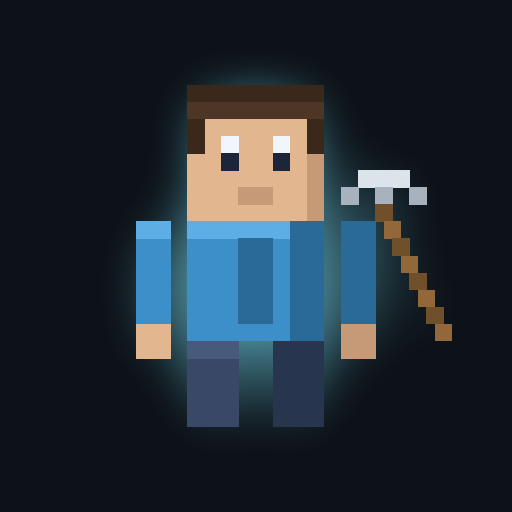

# ⛏ Voxel World — Lumen 之章

**立即遊玩** 👉 https://cchouse168.github.io/image-world/

單一 HTML 檔的 3D 方塊生存遊戲，純前端（Three.js + WebGL），無後端、可離線遊玩。

---

## 📲 安裝到手機（PWA）

- **Android（Chrome / Edge）**：開啟連結 → 等候「安裝應用程式」提示，或右上角「⋮」→ **安裝應用程式**
- **iPhone（Safari）**：開啟連結 → 分享鈕 → **加入主畫面**
- **桌面 Chrome**：網址列右側的 **安裝** 圖示

安裝後可全螢幕、離線遊玩，進度存在裝置本機。

掃描 QR Code：

---

## 🎮 操作

### 電腦（鍵盤滑鼠）
| 動作 | 按鍵 |
|---|---|
| 移動 / 疾跑 | `W A S D` / 按住 `Shift` |
| 跳躍・游泳上浮 | `Space` |
| 挖掘・攻擊 | 滑鼠左鍵（按住連續挖） |
| 放置方塊・射箭・喝藥水・開寶箱 | 滑鼠右鍵 |
| 切換快捷欄 | `1`–`9` 或滾輪（只顯示你擁有的道具） |
| 合成選單 | `Tab` |
| 藥水 | `H` 治療　`N` 夜視　`G` 金蘋果 |
| 存檔 / 讀檔 | `F5` / `F9` |

### 手機（觸控）
- **左半螢幕**：拖曳出虛擬搖桿移動（推到底＝疾跑）
- **右半螢幕**：拖曳轉動視角
- **右下按鈕**：`挖 / 攻`（可長按）、`跳`、`放 / 用`
- **右上按鈕**：⚒ 合成、🧪 藥水、💾 存檔、📂 讀檔、⏸ 暫停
- **點快捷欄格子**切換道具（選藥水按 `放 / 用` 就會喝下）　·　建議橫向持機

> 快捷欄只會出現你擁有的東西：一開始只有 ✋ 空手，合成或撿到道具後才會多出格子；剛合成的裝備會自動拿在手上。對戰用的槍與劍只在對戰中出現，回大廳後背包會還原。

---

## 👥 多人連線（同一個 Wi-Fi）

1. 兩台裝置（例如 iPad + Windows 筆電）都打開遊戲，在開始畫面填好名字
2. 第一台按 **🏠 進入大廳** → 走進一座夜色廣場，畫面上方會顯示 4 位數 **房號**
3. 第二台在 **🔗 加入朋友** 輸入房號按 **GO**，會直接出現在同一個大廳

### 🏛️ 大廳怎麼玩（用走的選模式）

| 地點 | 做什麼 |
|---|---|
| 西側 🟢 **協作之門** | 所有人走進去 → 倒數 3 秒 → 一起進入冒險世界 |
| 南側三座門：🔴🔵 **競技場 / 小鎮 / 雪峰峽谷** | 站 **紅毯半邊** = 紅隊、**藍毯半邊** = 藍隊、中線自動分到人少的一隊；所有人都站進同一座門就倒數開打 |
| 廣場中央踏板 | **死鬥 / 搶旗** 模式、**簡單 / 普通 / 困難** 電腦難度、**每隊人數 1–5**（踩一下就切換，全員同步） |

- 一個人也能玩：自己走進任一座門，空位由電腦補上
- 對戰結束可 **再來一場**（同隊伍同設定）或 **🏠 回大廳** 換地圖/模式；暫停選單也有「回大廳」
- 不想連線？開始畫面按 **⚡ 直接單人冒險**

**會同步的內容**：彼此的位置與動作（有名牌的方塊人）、挖掘與放置方塊、火把、寶箱、5 顆水晶的共用進度、傳送門、擊敗巨龍後的出口、晝夜時間。
**各自獨立的內容**：背包、血量、暗影怪與巨龍戰鬥（各自在自己畫面上打）。

- 連線使用 WebRTC P2P（PeerJS），不需要伺服器；建立/加入時需要網路
- **找同伴**：同伴頭上有玩家色光柱（遠處也看得到）；右上角顯示每位同伴的方向箭頭、距離與高度差；按 **📍**（手機）或 **T**（電腦）直接傳送到最近的同伴身邊
- 只有房主可以讀檔，讀檔後會自動同步給所有人
- 對方關掉頁面或切到背景約 8 秒後，會自動顯示離線並改為單人繼續

## ⚔️ PvP 對戰（團隊死鬥 / 搶旗）

開始畫面選 **⚔ 團隊死鬥** 或 **🚩 搶旗**：
- **建立對戰房間**：另一台輸入房號加入；在大廳選紅隊或藍隊，房主設定模式、**電腦難度（簡單／普通／困難）**、每隊人數（1–5），空位由電腦補滿 → 開始對戰
- **🤖 單機練習**：不用連線，自己跟電腦打
- 可以人類同隊打電腦，也可以人類分兩隊互打

**三張對戰地圖**（大廳可選，每場重置，不影響協作世界）：

| 地圖 | 特色 |
|---|---|
| 🏟 流明競技場 | 正午晴空：城堡基地與角樓、城垛外牆、三條路線、側線噴泉、中央水晶高台（狙擊槍）、遠山與浮空島 |
| 🏮 古鎮巷戰 | 黃昏古鎮：石板街與窄巷、木樑灰泥房、紅藍屋瓦街區、燈籠串、運河拱橋、市集、廣場鐘樓狙擊點 |
| 🏔 雪峰峽谷 | 冰河峽谷：三層梯台與石階、崖頂狙擊台、雪松林、木柵基地與營火、飄雪、遠方雪山 |

電腦玩家使用 A* 尋路，會沿三條路線分頭推進、爬梯台、繞過房屋。

| 模式 | 勝利條件 |
|---|---|
| 團隊死鬥 | 先達到目標殺數（每隊人數 × 5，最少 8），或 5 分鐘到時殺數較多 |
| 搶旗 | 把對方旗子帶回自家基地（自家旗子要在基地）得 1 分，先得 3 分；帶旗者被擊倒會掉旗，隊友碰到可送回 |

- 裝備：劍、手槍（無限子彈）、16 塊木板掩體（可拆）；撿到狙擊槍有 5 發
- 爆頭加傷（手槍 ×1.5、狙擊槍 ×2）、無友傷、重生後 2 秒無敵
- 記分板：電腦按住 **Tab**／手機點 **📋**；結算畫面有 MVP，房主可「再來一場」
- 對戰中途也能加入；對戰中不能存讀檔、不能傳送

## 🎵 音效與配樂

- 每個場景有自己的配樂：大廳、白天冒險、夜晚、終界、三張對戰地圖各一首，比賽最後 60 秒或比分接近時會加重，結算有專屬曲
- 全部即時合成（WebAudio），加上立體聲殘響與壓縮；腳步聲依材質（石、木、雪、冰、沙、水、草）不同，遠處槍聲有左右方位
- 暫停選單可分別調 **音樂 / 音效音量**（會記住），按 **M** 或 **🎵** 一鍵靜音配樂

## 🎯 狙擊槍

- 傷害 90（爆頭 ×2）、射程 130、拉栓 1.35 秒
- **右鍵**（電腦）／**瞄準** 按鈕（手機）開鏡：放大、瞄準鏡、靈敏度自動降低；不開鏡射擊會散布
- 協作模式：合成台 鐵×6 鑽×2 煤×2（附 5 發），狙擊彈 ×5＝鐵×1 金×1；可以打暗影怪和巨龍
- 細節：可動的槍機與滑套、拋出彈殼、星形槍口火光、彈孔；其他玩家與電腦會手持武器、舉槍瞄準，開鏡時鏡片會反光

---

## 🌍 世界

- **無邊界地形**：以玩家為中心動態生成、走遠自動卸載
- **五種生態系**：平原、熱帶草原（傘狀相思樹）、森林（橡木＋樺木）、雪山（錐形雲杉）、海洋，外加蜿蜒河流
- **地底**：3D 雜訊生成的連通洞穴系統、依深度分佈的礦脈（煤／鐵／金／鑽石）、深層岩漿池、不可破壞的基岩
- **結構物**：村莊（房舍＋道路＋寶箱）、廢棄礦坑（地下走廊＋木支架＋寶箱）、廢墟傳送門（殘缺黑曜石框＋岩漿）
- **晝夜循環**：約 200 秒一天，夜晚會有暗影怪出沒（火把與螢光石可驅趕，黎明會自燃）

## ⚔️ 玩法

1. 採集資源、用合成台做出工具與裝備
2. 收集散落各地的 **5 顆 Lumen 水晶**（跟著光柱與羅盤走，三顆藏在結構物裡）
3. 集齊後主世界傳送門開啟 → 進入 **終界浮空島**
4. 摧毀四座治癒塔阻止巨龍回血 → 擊敗 **流明巨龍** → 走進出口傳送門獲勝

**工具分工**：鎬挖石／礦／磚、斧砍木、鏟挖土／沙 —— 用對工具最高快 5 倍；鐵、金、鑽石礦**必須手持鎬**才會掉落。

## ✨ 技術特色

- 區塊化網格生成，只產生裸露面 + 頂點 AO（方塊內角自然變暗）
- 程式化生成的 16×16 像素貼圖集（不使用任何外部素材）
- 第一人稱手臂與持有道具，含揮動、走路擺動、換道具動畫
- GLSL 水面著色器（頂點波浪 + Fresnel 透明）
- WebAudio 即時合成音效，無音檔載入
- 存檔只記錄「玩家造成的方塊差異」，檔案極小

---

授權：MIT。本專案為原創作品，所有美術與程式皆由程式生成，未使用任何第三方遊戲素材。
