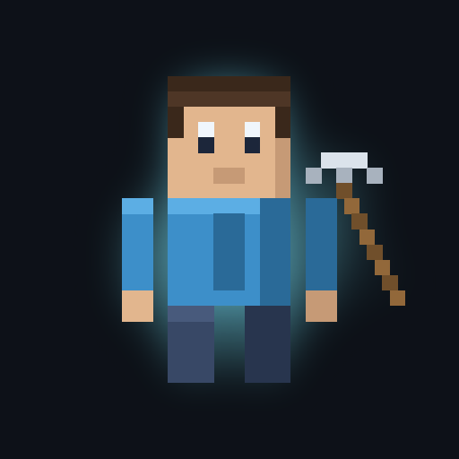

# ⛏ Voxel World — Lumen 之章

**立即遊玩** 👉 https://cchouse168.github.io/image-world/

單一 HTML 檔的 3D 方塊生存遊戲，純前端（Three.js + WebGL），無後端、可離線遊玩。

---

## 📲 安裝到手機（PWA）

- **Android（Chrome / Edge）**：開啟連結 → 等候「安裝應用程式」提示，或右上角「⋮」→ **安裝應用程式**
- **iPhone（Safari）**：開啟連結 → 分享鈕 → **加入主畫面**
- **桌面 Chrome**：網址列右側的 **安裝** 圖示

安裝後可全螢幕、離線遊玩，進度存在裝置本機。

掃描 QR Code：

---

## 🎮 操作

### 電腦（鍵盤滑鼠）
| 動作 | 按鍵 |
|---|---|
| 移動 / 疾跑 | `W A S D` / 按住 `Shift` |
| 跳躍・游泳上浮 | `Space` |
| 挖掘・攻擊 | 滑鼠左鍵（按住連續挖） |
| 放置方塊・射箭・開寶箱 | 滑鼠右鍵 |
| 切換快捷欄 | `1`–`9` 或滾輪（共 14 格） |
| 合成選單 | `Tab` |
| 藥水 | `H` 治療　`N` 夜視　`G` 金蘋果 |
| 存檔 / 讀檔 | `F5` / `F9` |

### 手機（觸控）
- **左半螢幕**：拖曳出虛擬搖桿移動（推到底＝疾跑）
- **右半螢幕**：拖曳轉動視角
- **右下按鈕**：`挖 / 攻`（可長按）、`跳`、`放 / 用`
- **右上按鈕**：⚒ 合成、🧪 藥水、💾 存檔、📂 讀檔、⏸ 暫停
- **點快捷欄格子**切換道具　·　建議橫向持機

---

## 🌍 世界

- **無邊界地形**：以玩家為中心動態生成、走遠自動卸載
- **五種生態系**：平原、熱帶草原（傘狀相思樹）、森林（橡木＋樺木）、雪山（錐形雲杉）、海洋，外加蜿蜒河流
- **地底**：3D 雜訊生成的連通洞穴系統、依深度分佈的礦脈（煤／鐵／金／鑽石）、深層岩漿池、不可破壞的基岩
- **結構物**：村莊（房舍＋道路＋寶箱）、廢棄礦坑（地下走廊＋木支架＋寶箱）、廢墟傳送門（殘缺黑曜石框＋岩漿）
- **晝夜循環**：約 200 秒一天，夜晚會有暗影怪出沒（火把與螢光石可驅趕，黎明會自燃）

## ⚔️ 玩法

1. 採集資源、用合成台做出工具與裝備
2. 收集散落各地的 **5 顆 Lumen 水晶**（跟著光柱與羅盤走，三顆藏在結構物裡）
3. 集齊後主世界傳送門開啟 → 進入 **終界浮空島**
4. 摧毀四座治癒塔阻止巨龍回血 → 擊敗 **流明巨龍** → 走進出口傳送門獲勝

**工具分工**：鎬挖石／礦／磚、斧砍木、鏟挖土／沙 —— 用對工具最高快 5 倍；鐵、金、鑽石礦**必須手持鎬**才會掉落。

## ✨ 技術特色

- 區塊化網格生成，只產生裸露面 + 頂點 AO（方塊內角自然變暗）
- 程式化生成的 16×16 像素貼圖集（不使用任何外部素材）
- 第一人稱手臂與持有道具，含揮動、走路擺動、換道具動畫
- GLSL 水面著色器（頂點波浪 + Fresnel 透明）
- WebAudio 即時合成音效，無音檔載入
- 存檔只記錄「玩家造成的方塊差異」，檔案極小

---

授權：MIT。本專案為原創作品，所有美術與程式皆由程式生成，未使用任何第三方遊戲素材。
